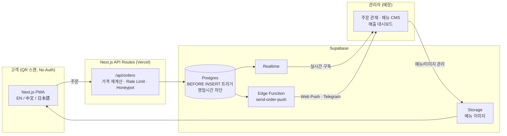

# 🍕 Pizza of Legend Express

> **"No Auth, No App, Just Pizza"** — 회원가입도, 앱 설치도 없이 QR 스캔 한 번으로 주문하는
> 외국인 관광객 대상 피자 주문 PWA. **실제 매장에 도입되어 운영 중인 실서비스**입니다.

| 항목 | 내용 |
|------|------|
| 프로젝트 유형 | 실제 업주 의뢰 · 실서비스 운영 (영종도 피자 매장) |
| 기간 | 2026.03 ~ 현재 (런칭 후 운영·개선 지속) |
| 인원 / 역할 | 1인 풀스택 — 기획 · 설계 · 개발 · 배포 · 운영 전담 |
| 라이브 서비스 | <!-- TODO: 배포 URL --> |
| GitHub | <!-- TODO: 저장소 URL --> |

<!-- TODO: 대표 스크린샷 3~4장 (메뉴보드 / 체크아웃 / 주문추적 / Admin 관제) -->

---

## 1. 문제 정의 — 왜 만들었나

영종도 호텔(파라다이스시티, 베스트웨스턴 등)에 묵는 **외국인 투숙객**은 피자 한 판을 시키는 데 장벽이 많다.

- 배달 앱은 한국 전화번호 인증·한국어 UI가 필수 → 외국인은 사실상 사용 불가
- 전화 주문은 언어 장벽으로 주문 실수 빈발
- 업주 입장에서는 배달 앱 수수료 부담

**해결 방향**: 객실에 비치된 QR을 스캔하면 브라우저에서 바로 열리는 다국어(EN/中文/日本語) 주문
웹앱. 회원가입·로그인·온라인 결제를 전부 제거하고(대면 결제), 대신 서버와 DB 레벨에서
무결성을 보장하는 구조로 설계했다.

---

## 2. 기술 스택

| 구분 | 기술 | 선택 이유 |
|------|------|----------|
| Framework | Next.js 14 (App Router) + TypeScript | 서버 컴포넌트로 초기 로딩 최적화, API Route로 백엔드 통합 |
| Styling | Tailwind CSS + shadcn/ui | 모바일 퍼스트 커스텀 디자인 시스템 구축 |
| i18n | next-intl | EN/ZH/JA 라우트 기반 다국어 (`/[locale]/...`) |
| 상태 관리 | Zustand | 장바구니 등 경량 클라이언트 상태 |
| DB / 인프라 | Supabase (Postgres · Realtime · Storage · Edge Functions) | 실시간 주문 관제 + 트리거 기반 비즈니스 룰 enforce |
| PWA | next-pwa | 홈 화면 설치, 오프라인 셸 |
| 테스트 | Playwright | E2E 스펙 10개 · 30+ 케이스 |
| 배포 | Vercel | 프리뷰 배포 기반 빠른 클라이언트 피드백 사이클 |

---

## 3. 아키텍처

- **고객 앱**: 메뉴보드 → 장바구니 → 체크아웃(호텔+호수) → 주문번호 `POL-YYYYMMDD-NNN` 발급 → 실시간 상태 추적 (Pending → Cooking → On the Way → Delivered)
- **관리자 앱**: PIN 로그인, 주문 관제센터(실시간), 메뉴 CMS(드래그 정렬·이미지 업로드), 배달 대시보드, 매출/정산 대시보드, 영업시간·알림 설정

---

## 4. 핵심 기술 과제와 해결

### 4-1. No Auth 구조에서 주문 무결성 지키기

**문제** — 인증이 없으므로 누구나 `/api/orders`에 임의 payload를 보낼 수 있다.
클라이언트가 보낸 가격을 그대로 믿으면 0원 주문 조작이 가능하다.

**해결** — 클라이언트 전송 가격을 **전혀 신뢰하지 않는** 서버 파이프라인 구축 (`src/app/api/orders/route.ts`)

- 주문 항목별로 DB(`menu_prices`)에서 가격을 다시 조회해 **서버에서 총액 재계산**
- 반반피자는 조합과 무관한 고정가 정책을 서버에서 강제
- **IP 기반 Rate Limiting** (5분당 10건, `429 + Retry-After`)
- **Honeypot 필드**: 봇이 숨김 필드를 채우면 가짜 성공 응답(`POL-00000000-000`)을 반환해
  봇이 차단을 눈치채지 못하게 처리
- 객실 번호는 `^\d{1,4}$` 정규식으로 서버 검증

> 인증을 없애는 대신 "서버가 모든 것을 재검증한다"는 원칙으로 UX와 보안을 맞바꾸지 않았다.

### 4-2. 영업시간 차단을 DB 트리거로 최종 enforce

**문제** — 영업시간(12:00–24:00) 외 주문을 클라이언트에서만 막으면, API 직접 호출이나
탭을 열어둔 채 자정을 넘기는 경우를 막을 수 없다.

**해결** — 방어선을 3중으로 두되, **최종 판정은 Postgres BEFORE INSERT 트리거**가 담당
(`supabase/migration_business_hours_and_size.sql`)

- `check_business_hours()` 트리거: `store_settings` JSONB 설정을 읽어 `Asia/Seoul` 기준 판정,
  `close <= open`이면 **자정 횡단 구간**(예: 18:00~02:00)까지 처리
- 트리거가 `STORE_CLOSED` / `STORE_CLOSED_MANUAL`(임시휴무) 예외를 던지면
  API가 이를 **409 + 에러 코드**로 매핑 → 클라이언트는 코드별 다국어 안내 표시
- UX 배려: 마감으로 주문이 거부돼도 **장바구니는 보존**, 브라우징은 허용하고 담기/주문만
  비활성화, 오픈 카운트다운 배너 노출
- 마이그레이션 시 과거 주문의 `order_items`는 가격 스냅샷을 보관하므로 가격 정책 변경
  (R 사이즈 폐지)이 과거 데이터를 깨뜨리지 않도록 설계

### 4-3. 실시간 주문 알림 — 놓치면 매출이 날아간다

**문제** — 매장에서 새 주문을 놓치면 곧바로 고객 클레임이다. 관리자가 화면을 안 보고 있거나,
브라우저가 백그라운드일 때도 알림이 도달해야 한다.

**해결** — 단계적으로 **4중 알림 채널**을 구축

1. **Supabase Realtime** 구독으로 관제센터 화면 즉시 갱신 (+ 폴링 폴백)
2. **TTS 음성 알림** — 주방에서 화면을 안 봐도 신규 주문을 음성으로 인지
3. **Web Push** (VAPID) — 브라우저가 닫혀 있어도 기기로 푸시
4. **Telegram 알림** — Supabase Edge Function(`send-order-push`)이 DB Webhook을 받아 발송

운영하며 잡은 실전 버그들:

- Realtime 콜백의 **stale closure**로 호텔명이 UUID로 표시되던 버그 → ref 패턴으로 해결
- 페이지 첫 로드 시 기존 주문까지 TTS로 읽어버리는 문제 → 초기 로드 억제 플래그,
  이후 "신규 주문을 놓치는" 과억제 부작용까지 재수정
- 탭이 보이는 상태에서 Web Push와 브라우저 Notification이 **중복 발송**되던 문제 →
  `document.hidden` 분기로 단일화
- Supabase의 신규 `sb_secret_*` 키 포맷에서 Edge Function JWT 검증이 실패하는 문제 →
  `verify_jwt=false` + 함수 내부 수동 시크릿 검증으로 전환

### 4-4. next-pwa × App Router — 프로덕션에서만 터지는 서비스워커 404

**문제** — 로컬에선 멀쩡한데 Vercel 프로덕션에서만 PWA가 동작하지 않았다.

**원인 추적** — next-pwa가 App Router의 `app-build-manifest.json`을 precache 목록에
포함시키는데, Vercel 프로덕션에선 이 파일이 서빙되지 않아 404 → precache 실패 →
**서비스워커 install 자체가 롤백**되는 구조였다.

**해결** — `next.config.mjs`의 `buildExcludes`로 해당 manifest를 precache에서 제외.
"로컬과 프로덕션의 정적 자산 서빙 차이"까지 내려가 원인을 특정한 사례.

### 4-5. 언어 장벽을 UI로 푸는 다국어 설계

- next-intl 라우트 기반 3개 언어(EN/ZH/JA) — UI 문구는 `messages/*.json`,
  **메뉴명·설명은 DB에서 locale별 컬럼**으로 관리해 업주가 CMS에서 직접 수정 가능
- 언어를 못 읽어도 주문할 수 있도록 **이미지 중심 UI**: 반반피자 조합·세트 구성을
  텍스트 대신 이미지 그리드 스텝으로 선택
- "Pay to the staff at your door"(대면 결제) 안내를 체크아웃 최상단 최대 크기로 배치 —
  결제 방식 오해로 인한 주문 취소 방지

---

## 5. 실서비스 운영 — 클라이언트 피드백 반영 사이클

프로토타입 납품이 아니라 **운영하면서 업주 요구를 지속 반영**한 프로젝트다.

| 시기 | 피드백 | 반영 |
|------|--------|------|
| 런칭 초기 | "포장 손님도 받고 싶다" | Delivery/Pickup 모드 분기, 픽업 시 호텔·호수 입력 제거 |
| 운영 중 | "게스트하우스는 동이 4개다" | 호텔 데이터 구조 확장, 동별 분리 |
| 운영 중 | "배달비가 합계에 안 보인다" | 총액에 배달비 표시 + E2E 테스트 추가 |
| 2026.06 | "R 사이즈 빼고 L만 팔겠다" | 가격 데이터 마이그레이션 + 코드 레벨 필터 (ENUM은 보존해 과거 주문 호환) |
| 2026.06 | "영업시간 외 주문이 들어온다" | DB 트리거 기반 영업시간 차단 + Admin 설정 화면 |

이 과정에서 배운 것: **요구사항은 런칭 후에 진짜가 나온다.** 스키마를 바꿀 때마다
과거 주문 데이터 호환(스냅샷 보존, ENUM 유지)을 먼저 검토하는 습관이 생겼다.

---

## 6. 품질 관리

- **Playwright E2E** — 주문 전체 플로우, 반반피자, 가격 검증, 다국어, 에러 케이스 등
  스펙 10개 / 30+ 케이스. 특히 **서버 가격 재계산을 우회하는 조작 시나리오**를 테스트로 고정
- 컴포넌트에 `data-testid`를 체계적으로 부여해 셀렉터 안정성 확보
- TypeScript strict 모드, Supabase 쿼리는 `lib/` 레이어로 추상화 (컴포넌트 직접 쿼리 금지)
- 호텔 Wi-Fi 환경 고려: 이미지 클라이언트 압축(browser-image-compression) 후
  Supabase Storage 업로드, `next/image` 최적화, 번들 최소화

---

## 7. 숫자로 보는 프로젝트

- 커밋 **54개** (기능 개발 → 런칭 → 운영 개선의 전체 사이클)
- TypeScript 소스 **116개+ 파일**, API Route **20개+**
- 지원 언어 **3개** (EN / 中文 / 日本語)
- E2E 테스트 스펙 **10개 / 30+ 케이스**
- 알림 채널 **4중화** (Realtime · TTS · Web Push · Telegram)
- 주문 상태 실시간 추적 **4단계** (Pending → Cooking → On the Way → Delivered)

---

## 8. 회고

**잘한 것**
- "인증 제거"라는 UX 결정을 보안 저하 없이 성립시킨 설계 — 신뢰 경계를 클라이언트가 아닌
  서버·DB에 두는 원칙을 끝까지 유지
- 비즈니스 룰(영업시간, 고정가)을 애플리케이션 코드가 아닌 **DB 레벨에서 enforce** —
  어떤 경로로 들어와도 뚫리지 않는 최종 방어선
- 런칭이 끝이 아니라 시작이었다 — 운영 버그(stale closure, 알림 중복, SW 롤백)를
  재현 → 원인 특정 → 수정 → 테스트 고정의 사이클로 해결

**아쉬운 것 / 다음 단계**
- Admin 인증이 PIN 방식 — Supabase Auth 전환 예정
- Rate limit이 인메모리 방식이라 서버리스 인스턴스 간 공유되지 않음 — Redis(Upstash) 등
  외부 스토어 전환 검토
- 주문 데이터가 쌓이는 중 — 메뉴별 판매 분석 등 데이터 기반 기능 확장 여지
